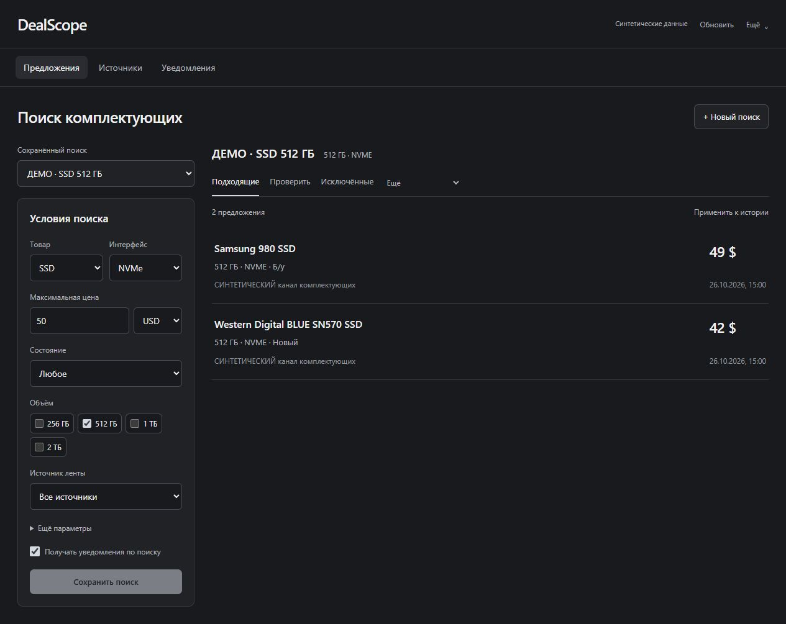
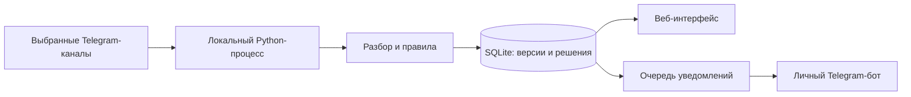
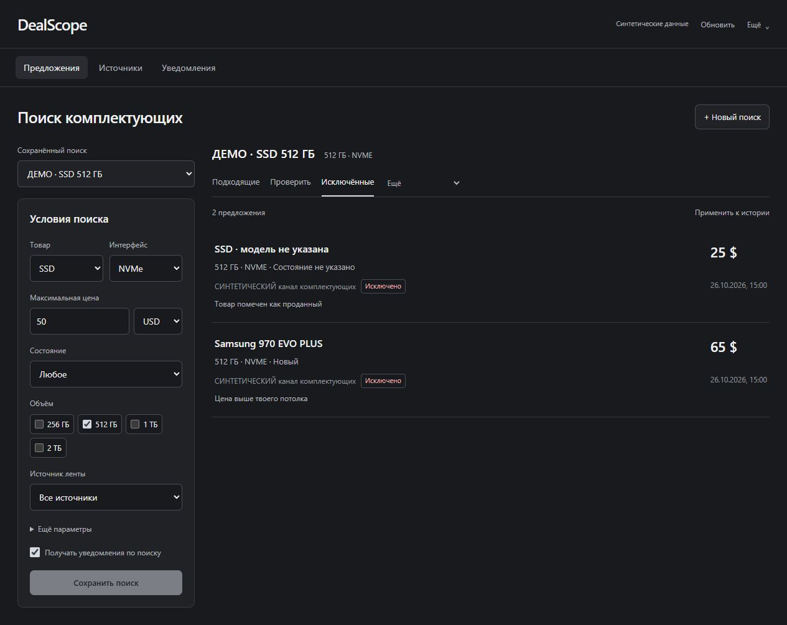
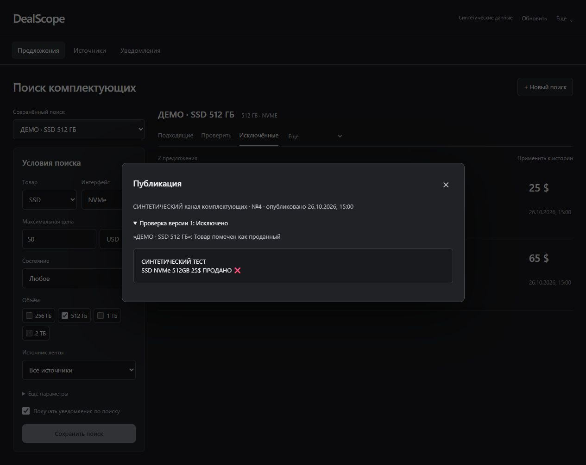
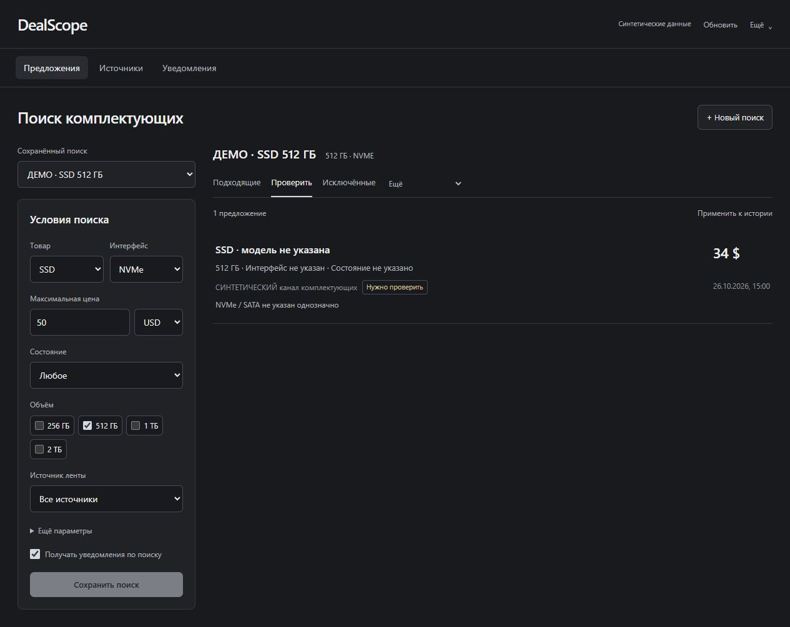
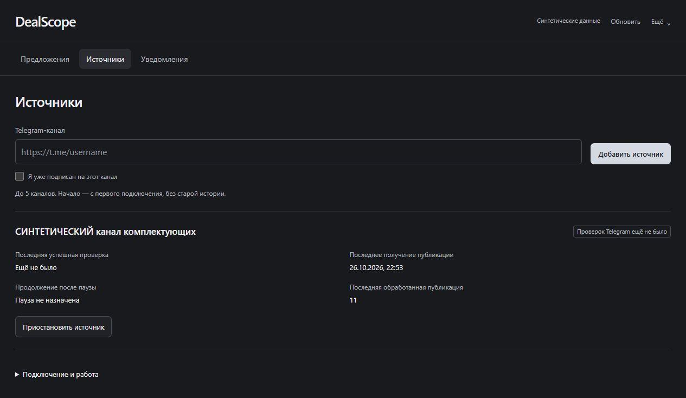
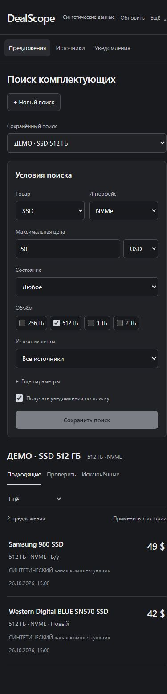

# DealScope

**Новые предложения по комплектующим — с понятными правилами отбора.**

[](https://github.com/Aturm4/DealScope/actions/workflows/repository-checks.yml)

Python 3.12 · SQLite · Telegram · HTML / CSS / JavaScript · Windows

DealScope собирает новые объявления из выбранных Telegram-каналов, проверяет их
по сохранённым условиям и объясняет результат. Основной сценарий — поиск SSD NVMe
512 ГБ и 1 ТБ: пользователь сам задаёт цену, объём, интерфейс и другие ограничения.

Данные и обработка остаются на компьютере владельца. Разбор объявлений работает
на словарях, регулярных выражениях и явных правилах.



> Все шесть скриншотов сняты в работающем приложении на вымышленных объявлениях.
> Маркировки «Синтетические данные» и «ДЕМО» сохранены. Снимки показывают интерфейс,
> а не реальное чтение Telegram или доставку уведомлений.

## Что умеет

- **Сохранённые поиски:** цена и валюта, объём, интерфейс, бренд, модель, состояние,
  ключевые слова и исключения.
- **Объяснимые решения:** вкладки «Подходящие», «Проверить» и «Исключённые» с причинами
  и исходным текстом объявления.
- **Учёт изменений:** версии публикаций, признаки продажи и защита от повторной обработки.
- **Управление источниками:** до пяти выбранных публичных Telegram-каналов за одну
  сессию, отдельные состояния ошибок и пауз.
- **Уведомления своему владельцу:** отдельный Telegram-бот, явная привязка получателя,
  очередь и история результатов отправки.
- **Локальный веб-интерфейс:** адаптивная лента, фильтры, источники и состояние проверок.
  Дополнительный приватный Sites-интерфейс подключается к ПК временным кодом.

## Решения, на которых построен проект

**Неполные характеристики требуют проверки.** Упоминание M.2 само по себе не
подтверждает NVMe. Неоднозначное объявление попадает в отдельную категорию.

**Причина важнее одного флага.** Цена выше потолка, проданный товар и неподходящее
состояние показываются отдельно. Категория исключений относится к текущему поиску.

**Повторная проверка сохраняет историю.** Изменение условий позволяет пересчитать
сохранённые объявления; старые публикации при этом не превращаются в новые уведомления.

**Результаты отправки учитываются явно.** При неизвестном результате доставка
не повторяется автоматически: это снижает риск дублирования сообщения.

## Быстрый запуск: офлайн-демо

Для демо достаточно **Windows и Python 3.12**. Ключи API и Telegram-аккаунт для него
не требуются; ядро использует стандартную библиотеку Python.

```powershell
git clone https://github.com/Aturm4/DealScope.git
cd DealScope
py -3.12 -m venv .venv

.\.venv\Scripts\python.exe -B -m dealradar --db data/demo.sqlite3 demo
.\.venv\Scripts\python.exe -B -m dealradar --db data/demo.sqlite3 ui --port 8765
```

Откройте **http://127.0.0.1:8765**. Для остановки используйте Ctrl+C.
Демо создаёт отдельную синтетическую базу; для реального мониторинга нужна другая база.

Подключение Telegram, установка закреплённых зависимостей и необязательный
приватный интерфейс описаны в [инструкции запуска](docs/SETUP.md).

## Как устроено



[Подробнее об архитектуре](docs/ARCHITECTURE.md).

## Скриншоты

<details>
<summary><strong>Исключённые объявления и исходный текст</strong></summary>

Цена выше потолка и проданный товар имеют отдельные причины.



Оригинал публикации и решение сохранены вместе.



</details>

<details>
<summary><strong>Неоднозначные характеристики и источники</strong></summary>





</details>

<details>
<summary><strong>Мобильный интерфейс</strong></summary>



</details>

## Проверки

```powershell
.\.venv\Scripts\python.exe -B -m unittest discover -s tests -q
node --check dealradar/web/app.js
node --check dealradar/web/connect.js
node --check site/bridge.js
node --check site/build.mjs
```

Полный набор транспортных тестов требует зависимостей из
`requirements-telegram.txt`. В CI они устанавливаются с проверкой хешей;
живые аккаунты Telegram и личные базы не используются.

## Границы текущей версии

- Ориентир «подходит по цене» — заданный пользователем потолок. Рыночная стоимость
  и выгодность покупки автоматически не оцениваются.
- Поддерживаются USD и UZS; автоматического пересчёта валют нет.
- Анализируется текст объявления. Распознавание изображений и OCR не реализованы.
- Мониторинг работает, пока ПК включён и запущен локальный процесс.
- Магазины и OLX не интегрированы.
- Доступность товара может измениться после последней проверки.
- Пользовательская сессия Telegram имеет широкие права аккаунта.
  Ограничения клиентского кода не изолируют её ключ от остального аккаунта.

[Работа с данными и секретами](SECURITY.md) ·
[Вклад в проект](CONTRIBUTING.md)

Автор: [Amir Turaev](https://github.com/Aturm4).
